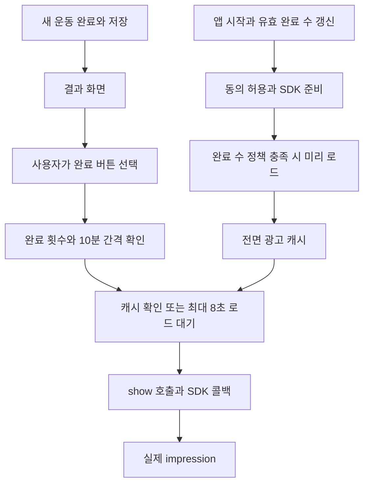

# MotionFit iOS 1.6.6 광고 미노출 원인 분석

분석일은 2026년 10월 17일이며, 사용자 확인 조회 기간은 2026년 9월 19일~10월 16일이다. **광고를 막을 수 있는 코드 결함이 있다. 특히 이전 구현의 동의 실패 재시도 차단과 광고 로드 호출 예외 후 상태 복구 누락은 수정 대상이다.** 다만 제공된 Analytics와 AdMob 자료는 플랫폼·버전이 혼합되어 있어, 이 결함들의 iOS 1.6.6 운영 발생 횟수나 기여율까지 확정할 수는 없다.

로컬에서 **Apple 업로드 성공 기록이 있는 iOS 1.6.6(66) 아카이브**를 발견했다. 광고 관련 바이너리 문자열은 현재 HEAD보다 이전 구현과 일치한다. 따라서 현재 HEAD에서 발견한 모든 문제를 배포된 1.6.6의 원인으로 취급하면 안 된다.

## 1 배포본에 가까운 분석 기준

| 근거 | 확인 내용 |
| --- | --- |
| 현재 저장소 | `0f608c59abbe59afe20da257f169a1ab48c54735`; 직전 소스 변경 기준은 `6d9a3f7`, HEAD 자체 변경은 기존 보고서 추가 |
| 현재 iOS 설정 | Runner 1.6.6 / build 66; pubspec은 Android용으로 사용된 1.6.15+2026091801 |
| 실제 아카이브 | `/Users/nam/Library/Developer/Xcode/Archives/2026-09-08/Runner 9-8-26, 8.28 PM.xcarchive` |
| 아카이브 앱 식별자 | `fit.motionfit.app`, 1.6.6, build 66 |
| 생성 시각 | 2026-09-08 20:28:32 KST |
| 업로드 기록 | `uploadDestination=App Store`, `uploadedBuildNumber=66`, `uploadEvent.state=success`; 2026-09-08 20:31:47 KST |
| Dart AOT 바이너리 SHA256 | `aa868e068f3d9cc2ef3f0813ddb3ade23a69865eea2c441757889460f98304a6` |
| 소스 비교 후보 | `f8999266c3ee12c7f10fa3b0c3f2559809f06cb5`, 2026-09-09 11:18:29 KST 커밋 |

아카이브의 `Products/Applications/Runner.app/Info.plist`와 `Frameworks/App.framework/App`를 직접 읽었다. 업로드 성공은 확인됐지만, **App Store에서 이 빌드가 실제 공개된 상태와 정확한 소스 SHA는 기록만으로 확정되지 않는다.** 후보 커밋은 아카이브 생성 다음 날 작성됐다. 아래의 ‘이전 구현’은 이 후보의 소스 분석이며 바이너리와 전체 소스가 동일하다는 뜻은 아니다.

| 바이너리에서 확인한 문자열 | 배포 계열 식별에 주는 근거 |
| --- | --- |
| `before_first_workout`, `_waitForInterstitial` 존재 | 첫 완료 이후 허용·광고 로드 대기를 갖춘 이전 구현과 일치 |
| `BottomNativeAd`, `/1414718708`, `/2998795518` 존재 | 이전 네이티브·전면 광고 구현과 iOS 운영 단위에 부합 |
| `mf2_ad_request_attempted`, `mf2_ad_skipped_by_policy` 존재 | Flutter mf2 광고 이벤트 계열과 일치 |
| `BottomBannerAd`, `/2773965626`, `first_workout_protected` 미발견 | 9월 14일·18일 이후 변경이 이 아카이브의 원인이라는 주장에 근거가 없음 |

문자열 미발견만으로 코드 부재를 완전히 증명할 수는 없다. 생성 시각·양성 문자열·Git 변경 이력을 함께 사용했다. 원본 아카이브의 개인정보성 배포 식별자는 보고서에 복사하지 않았다.

### 이전 구현과 현재 코드의 차이

| 항목 | 이전 구현 `f899926` | 현재 HEAD |
| --- | --- | --- |
| 전면 광고 시작 조건 | 유효 운동 1회 완료 이후 | 유효 운동 2회 완료 이후 |
| 표시 시 준비가 부족하면 | SDK 초기화 및 최대 8초 로드 대기 | 준비된 광고가 없으면 즉시 반환 |
| 완료 횟수 조회 | provider 무효화 후 `.future` 대기 | `.value`를 즉시 읽음 |
| 홈·도전·설정 하단 | 네이티브 | 배너 |
| 동의 실패 복구 | 완료된 실패 Future 계속 재사용 | 정보 갱신 실패는 memo 해제, 양식 실패는 공백 잔존 |
| 앱 복귀 초기화 재시도 | 이후 추가된 복귀 보완 없음 | SDK 미준비일 때 재시도 |
| 결과 완료 버튼 | 부가 알림 작업 중에도 비활성 | 부가 작업 의존 제거 |

`d1a0896`(9월 14일), `bf9ef60`·`b469411`(9월 18일)의 변경을 9월 8일 아카이브에 소급 적용하지 않는다.

## 2 혼합 로그에서 확정할 수 있는 것

붙여넣은 파일은 1~250번 이벤트 50,690건이며, 메시지의 251~277번 각 1건을 더하면 **277종·50,717건**으로 제시된 합계와 맞는다. 354명은 전체 보고서 사용자 수이며, 이벤트별 사용자 수를 더해 다시 계산하지 않는다. 전체 이벤트의 출처 분류는 [evidence.json](/Users/nam/projects/flutter/motionfit/reports/ios_1_6_6_ads_2026_10_17/evidence.json)에 저장했다.

| 이벤트 | 전체 혼합 건수 | 해당 iOS 버전에 대한 판정 |
| --- | ---: | --- |
| `mf2_ad_request_attempted` | 1,451 | 이전/현재 Flutter 소스에 발행 경로 존재. iOS·Android 및 버전은 구분 불가 |
| `mf2_ad_skipped_by_policy` | 193 | 같은 계열. 요청 건수와 같은 사용자의 같은 기회라는 보장 없음 |
| `mf2_workout_completed` / `mf2_workout_summary_viewed` | 84 / 82 | 같은 계열이지만 iOS 1.6.6의 완료 수나 광고 기회 수로 사용 불가 |
| `ad_request_started` / `ad_load_succeeded` / `ad_load_failed` | 881 / 533 / 243 | 조사한 Flutter 소스의 발행 이벤트와 다름. 별도 구현·버전 등 출처 미확정 |
| `ad_show_attempted` / `ad_show_succeeded` | 315 / 311 | 위와 동일. 311/315를 iOS 1.6.6 show 성공률로 해석 불가 |
| `interstitial_request_started` / `interstitial_load_succeeded` | 149 / 103 | 조사한 Flutter 광고 서비스의 이벤트 이름과 다름 |
| `interstitial_impression` / `interstitial_shown` | 4 / 1 | 이름만으로 1.6.6, 또는 스크린샷의 1회 노출과 연결 불가 |
| `native_ad_failed` / `native_ad_impression` | 27 / 1 | 조사한 Flutter 구현이 직접 발행하지 않음. 원인을 iOS 네이티브 렌더링으로 단정 불가 |
| `ads_sdk_init_started` / `ads_sdk_init_succeeded` | 229 / 182 | 이 Flutter 광고 서비스의 Analytics 이벤트가 아님 |
| `consent_update_failed` | 20 | 동의 오류의 혼합 신호. iOS 1.6.6에서 발생한 20건이라는 뜻은 아님 |
| `ad_impression` | 653 | SDK 자동 계측과 여러 플랫폼·버전이 섞일 수 있는 공통 이벤트 |

`anonymous_auth_failed` 4,164건, `entitlement_*`, `purchase_completed` 등도 이 Flutter 광고 서비스의 필수 선행 단계로 연결되지 않는다. **인증 실패 때문에 iOS 1.6.6 광고가 전부 차단됐다는 결론은 코드 근거가 없다.** 발행 경로 미발견 이벤트를 모두 Android로 분류하지도 않는다. 다른 iOS 구현이나 버전일 수 있다.

또한 이전 구현의 앱 초기화 `mf2_ad_skipped_by_policy`는 `format=all`, `before_first_workout`을 기록하면서도 동의·SDK 초기화를 계속 진행한다. 네이티브 최소 완료 수는 0이다. 따라서 이 skip 이벤트를 ‘모든 광고를 실제로 차단한 횟수’로 해석하면 과대 집계한다. 근거는 `f899926:lib/app/app.dart:232`와 같은 revision의 `ad_eligibility.dart:4`다.

### AdMob 스크린샷 재해석

| 화면의 행 | 요청 | 노출 | 단순 노출/요청 |
| --- | ---: | ---: | ---: |
| 1.6.6 네이티브 광고 고급형 | 36 | 16 | 44.44% |
| 1.6.6 전면 광고 | 72 | 1 | 1.39% |
| 보이는 두 행의 합 | 108 | 17 | 15.74% |
| 화면 요약 | 154 | 17 | 11.04% |

사용자가 필터 미적용이라고 확인했으므로 **이 표의 1.6.6은 버전 차원이며 iOS 전용 집계가 아니다.** 기간·플랫폼·앱 필터를 다시 맞춰야 한다. 화면 요약 154와 보이는 행 108의 차이 46건은 특정 형식이나 iOS로 배분하지 않는다.

또한 72요청 중 1노출은 낮은 요청 대비 노출 비율이지만, **71개의 로드된 광고가 표시되지 않았다는 뜻은 아니다.** 이 화면에는 일치 요청 수가 없다. 공식 show rate의 분모는 요청이 아니라 일치 요청이며, 광고 소스 차원과 요약의 요청 집계 방식도 다를 수 있다. [AdMob 지표 정의](https://support.google.com/admob/answer/10979428?hl=en)

## 3 코드상 결함과 영향 범위

아래 ‘확정 결함’은 명시한 입력·실패 조건에서 코드가 복구하지 못한다는 뜻이다. 운영 발생 여부·빈도는 별도로 계측해야 한다.

### F1 동의 실패 결과가 프로세스 동안 고정됨

**P1, 이전 구현의 확정 결함. 모든 광고 형식의 요청 자체를 막을 수 있다.**

`f899926:lib/core/privacy/privacy_consent_service.dart:18`은 `_requestOperation ??= _requestTrackingAndConsent()`로 결과를 저장한다. 정보 갱신 오류·20초 timeout·양식 오류 후에도 memo를 비우지 않는다. `AdService.initialize()`는 `canRequestAds()==false`이면 종료한다.

재현 조건은 ‘기존 유효 동의가 없는 사용자 → 최초 UMP 일시 실패 → canRequestAds=false → 네트워크 복구 → 다시 광고 준비 호출’이다. 마지막 호출은 이미 끝난 Future만 받으므로 새로운 UMP 갱신이 실행되지 않는다. 일반적인 운동 완료 재시도만으로도 해결되지 않는다. 앱 프로세스 재시작까지 광고가 막힐 수 있다.

현재 [privacy_consent_service.dart:26](/Users/nam/projects/flutter/motionfit/lib/core/privacy/privacy_consent_service.dart:26)은 정보 갱신 실패만 일부 복구한다. 정보 갱신 성공 시 `_consentInfoResolved=true`가 되므로 이후 **필요 양식이 실패하고 canRequestAds=false로 남는 경우**에는 같은 문제가 남는다. ‘정보를 받았다’와 ‘동의 절차가 정상 종료됐다’를 분리해야 한다.

동의 오류가 있어도 이전 세션의 허용 상태가 있으면 광고 요청이 가능할 수 있으므로 매번 SDK `canRequestAds()`를 확인해야 한다. 오류를 성공으로 간주하거나 사용자의 선택을 반복 팝업으로 바꾸면 안 된다. [Google UMP 안내](https://developers.google.com/admob/flutter/privacy)

### F2 광고 load Future 오류를 처리하지 않아 loading 상태가 남음

**P1, 이전/현재 구현의 확정된 예외 복구 결함. 실제 SDK 호출 예외 발생률은 미확인이다.**

전면 광고는 `_interstitialLoading=true` 이후 `InterstitialAd.load()`의 Future를 await/catch하지 않는다. 이 Future가 네이티브 채널 오류로 실패하고 정상 `onAdFailedToLoad` 콜백이 오지 않으면 loading을 내리는 경로가 없다. 모든 후속 요청은 loading guard에서 반환한다. 이전 구현의 8초 표시 대기는 호출자만 timeout시키며 loading 상태를 복구하지 않는다.

근거: `f899926:lib/core/ads/ad_service.dart:223,246,254`; 현재 [ad_service.dart:229](/Users/nam/projects/flutter/motionfit/lib/core/ads/ad_service.dart:229). 설치된 plugin 9.0.0의 `ad_containers.dart:1170`과 `ad_instance_manager.dart:538`에서 실제 반환값이 플랫폼 호출 Future임을 확인했다.

네이티브도 [bottom_native_ad.dart:228](/Users/nam/projects/flutter/motionfit/lib/core/ads/bottom_native_ad.dart:228)의 `unawaited(ad.load())`에 오류 처리가 없다. 실패하면 `_loading`과 `_ad` 때문에 해당 위젯이 살아 있는 동안 재시도가 막힐 수 있다. 파일은 이전 구현과 동일하다. 현재 배너도 [bottom_banner_ad.dart:173](/Users/nam/projects/flutter/motionfit/lib/core/ads/bottom_banner_ad.dart:173)가 동일하며, 외부 `try`는 await하지 않은 Future 오류를 잡지 못한다. **배너 부분은 9월 8일 아카이브 원인에 포함하지 않는다.**

일반적인 AdMob no-fill은 실패 콜백을 통해 현재도 재시도한다. 모든 로드 실패가 이 결함을 유발하는 것은 아니다.

### F3 모든 광고 초기화가 운동 기록 조회에 종속됨

**P1, 이전/현재 구현의 조건부 차단 경로. DB 오류·지연이 발생했는지는 운영 자료로 미확인이다.**

앱의 `_runPrivacyConsentRefresh()`는 세 운동의 전체 기록을 합치는 provider를 먼저 await한 뒤 UMP·SDK를 시작한다. 기록 조회가 실패하면 catch에서 비치명 오류만 기록하고 그 시도의 광고 초기화는 중단한다. 기록이 지연되면 홈 네이티브까지 함께 지연된다. 전면 광고의 횟수 정책과 관계없는 광고 형식까지 같은 의존성을 갖는 것이 문제다.

근거: `f899926:lib/app/app.dart:220`; 현재 [app.dart:275](/Users/nam/projects/flutter/motionfit/lib/app/app.dart:275), [combined_workout_metrics.dart:23](/Users/nam/projects/flutter/motionfit/lib/features/exercise/application/combined_workout_metrics.dart:23). SDK·동의 준비는 독립시키고, 완료 횟수를 모를 때에는 전면 광고 정책만 보수적으로 처리한다.

### F4 요청 이후의 결과 계측이 비어 있음

**P1, 이전/현재 구현에서 확정된 진단 결함. 그 자체가 SDK 표시를 막는 원인은 아니다.**

[analytics_service.dart:743](/Users/nam/projects/flutter/motionfit/lib/core/analytics/analytics_service.dart:743)의 `adLoaded`, `adShown`, `adDismissed`, `adFailed`, `adClick`은 빈 구현이다. 이전 구현에서도 동일하다. 요청 이벤트만 있어 ‘요청 실패’, ‘로드 후 화면 이탈’, ‘표시 조건 탈락’, ‘show 호출 실패’를 구분할 수 없다. SDK 자동 `ad_impression`은 실제 노출을 알려 주지만 그 이전의 누락 원인은 설명하지 못한다.

모든 네이티브 위치를 `bottom_navigation`으로 기록하는 것도 문제다. 기록 상세·rep review·플랭크 결과에서 발생한 요청을 홈 요청과 구분할 수 없다. `request_id`, `opportunity_id`, 오류 code/domain, 캐시 수명, 화면 활성 상태가 필요하다.

## 4 노출 기회와 준비 시점의 구조적 손실

### 전면 광고는 요청만으로 표시되지 않음

이전 구현의 일반 운동 경로는 다음과 같다. 전면 광고는 명시적인 `show()`가 필요하고 load와 impression은 다른 단계다. [Google 전면 광고 안내](https://developers.google.com/admob/flutter/interstitial)

기존 완료 이력이 있는 사용자는 앱을 열기만 해도 미리 로드할 수 있다. 하지만 새 운동을 끝내고 결과의 완료 버튼까지 도달하지 않으면 표시 기회가 생기지 않는다. 표시가 끝난 직후 다음 광고도 다시 로드하므로, 사용자가 더 운동하지 않으면 그 요청은 노출로 이어지지 않는다. 정상적인 정책·사용자 이탈도 낮은 요청 대비 노출 비율에 포함된다.

이전 구현은 캐시가 없을 때 최대 8초만 대기한다. 그보다 늦게 로드되면 화면 전환이 끝나 이번 기회에서는 표시하지 않고 다음 기회를 기다린다. 앱 시작·직전 완료 직후와 같이 실제 표시 기회와 멀리 떨어진 preload를 줄이고, 운동 진행 중 다음 합법적인 전환을 준비하는 편이 낫다.

이전 결과 화면의 완료 버튼은 `_postCompletionActionsLoading`에도 묶여 있다. 알림 환경 갱신이 오래 걸리면 버튼과 광고 진입이 지연된다. 근거는 `f899926:lib/features/squat/presentation/screens/workout_summary_screen.dart:306,331`이며 푸시업·플랭크에도 같은 구조가 있다. 이는 조건부 UI 병목으로 분류하며 운영 발생은 미확인이다.

### 네이티브는 로드 시점과 실제 화면 노출이 다름

네이티브는 [bottom_native_ad.dart:143](/Users/nam/projects/flutter/motionfit/lib/core/ads/bottom_native_ad.dart:143)에서 로드된 후에야 AdWidget을 만든다. 로드 전에 화면이 사라지면 광고를 dispose하며, 스크롤 아래 위치는 로드되어도 보이지 않을 수 있다. 이 자체는 정상 수명 관리다.

다만 화면 전환 시 슬롯이 제거되면 재요청하게 되고, foreground·viewport 상태와 별개로 재시도하며, 로드가 종료되지 않는 경우의 timeout이나 배너 대체 경로가 없다. `nasdaq`은 해당 부분에 15초 제한·배너 대체·활성 상태 관리가 있다. 구조 개선 대상이지만 **네이티브 36요청/16노출의 20건을 전부 이 원인으로 귀속할 수는 없다.**

MotionFit은 Google 제공 `nativeTemplateStyle`을 사용한다. 자체 Swift NativeAdFactory가 없다는 이유만으로 오류라고 볼 수 없다. plugin의 `FLTGoogleMobileAdsPlugin.m:410`은 factory와 templateStyle이 모두 없을 때만 해당 오류를 반환한다. iOS 101pt 높이 역시 실제 렌더링 증거 없이 미노출 원인으로 단정하지 않는다.

## 5 현재 HEAD에 추가로 남아 있는 위험

다음은 후속 배포에서 막아야 할 문제이며, 발견한 9월 8일 아카이브의 주원인으로 사용하지 않는다.

| 문제 | 코드 근거 | 개선 방향 |
| --- | --- | --- |
| 빈 캐시·55분 만료 캐시에서 show가 재준비 없이 종료 | [ad_service.dart:121](/Users/nam/projects/flutter/motionfit/lib/core/ads/ad_service.dart:121), :206; [app.dart:130](/Users/nam/projects/flutter/motionfit/lib/app/app.dart:130) | foreground·다음 기회에 준비. 완료 갱신으로 재로드되는 경우도 있어 항상 막히는 것은 아님 |
| 완료 횟수 `.value`가 null 또는 이전 값이면 즉시 종료 | [post_workout_interstitial.dart:10](/Users/nam/projects/flutter/motionfit/lib/core/ads/post_workout_interstitial.dart:10) | 저장된 완료 snapshot 사용. Riverpod refresh가 항상 null이라는 주장은 하지 않음 |
| 두 번째 완료 이후부터 preload하는데 즉시 완료 버튼을 누르면 로드가 늦음 | [ad_eligibility.dart:6](/Users/nam/projects/flutter/motionfit/lib/core/ads/ad_eligibility.dart:6), [ad_service.dart:222](/Users/nam/projects/flutter/motionfit/lib/core/ads/ad_service.dart:222) | preload 허용 시점과 show 허용 시점을 분리하고 자연스러운 전환을 준비 |
| iOS·Android 배너 운영 ID가 동일 | [ad_unit_ids.dart:6](/Users/nam/projects/flutter/motionfit/lib/core/ads/ad_unit_ids.dart:6) | 콘솔에서 단위의 앱·플랫폼 매핑 확인 후 올바른 iOS ID로 확정. 현재 문자열만으로 서버 귀속은 알 수 없음 |
| Debug/Profile도 운영 ID 사용 | [ad_unit_ids.dart:19](/Users/nam/projects/flutter/motionfit/lib/core/ads/ad_unit_ids.dart:19) | 명시적 테스트 모드 복원. 이전 후보의 테스트 ID 분기는 존재 |

ATT 거부는 이 코드에서 전체 광고 금지 조건이 아니다. SDK 버전도 두 프로젝트가 plugin 9.0.0 / iOS GMA 13.3.0 / UMP 3.1.0으로 같으므로, 단순히 SDK 버전 차이가 원인이라는 근거는 없다. 코드에 없는 인증·PRO·복싱 광고 경로를 가정해 원인을 만들지 않는다.

## 6 최종 판단과 다음 실행 순서

**코드가 문제없다는 결론은 부적절하다. F1·F2의 복구 결함은 실제로 광고를 차단할 수 있다.** F3의 초기화 의존성과 표시 기회에 맞지 않는 준비 시점도 개선 대상이다. 반대로 혼합된 운영 숫자만으로 이 중 하나가 iOS 1.6.6 미노출의 대부분을 차지한다고 단정할 수는 없다.

먼저 플랫폼·앱·버전을 분리한 AdMob 요청/일치 요청/노출과 Analytics 원시 데이터를 맞추고, 같은 작업 단위에서 F1·F2 복구와 F4 계측을 보완한다. 이후 원인별 비율에 따라 preload·네이티브 fallback을 개선한다. [개선 계획](/Users/nam/projects/flutter/motionfit/reports/ios_1_6_6_ads_2026_10_17/improvement_plan.md), [nasdaq 코드 비교](/Users/nam/projects/flutter/motionfit/reports/ios_1_6_6_ads_2026_10_17/nasdaq_comparison.md), [분리 조회 SQL](/Users/nam/projects/flutter/motionfit/reports/ios_1_6_6_ads_2026_10_17/ios166_cohort.sql)을 별도 파일로 제공한다.

이번 변경은 분석 산출물이다. 앱 소스 수정·빌드·실기기 재현·BigQuery 실행은 포함하지 않는다. 최종 품질 기준은 ‘허용된 준비 광고와 유효 표시 기회가 있는데 코드가 조용히 놓치는 경우 0건’이며, 광고 재고·네트워크·동의 미허용까지 포함한 모든 요청의 노출을 보장한다는 뜻은 아니다.
